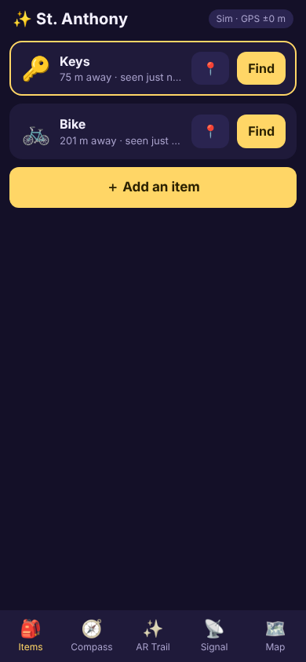
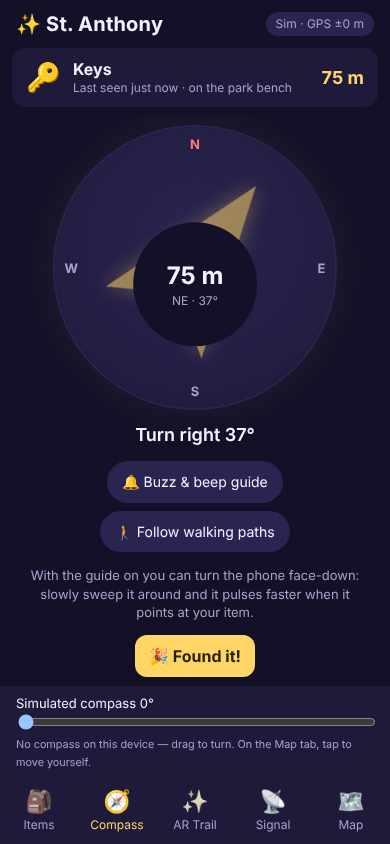

<p align="center"></p>

# ✨ St. Anthony

Find what's lost. St. Anthony remembers where you left your things and guides
you back to them with a compass arrow, a pixie-dust trail in your camera, and a map.

There are two versions in this repo:

- **Android app** (`android/`) — the main one. Native sensors, Bluetooth and
  Wi-Fi signal finding. See [Android app](#android-app) below.
- **Web app** (repo root) — the original prototype; runs in any phone browser.

No account, no server — your items stay on your device.

<p align="center">
  
  &nbsp;&nbsp;
  
</p>
<p align="center"><sub>The web app in <code>?demo</code> mode: your items, and the compass guiding you back to the keys.</sub></p>

## Android app

**Install:** on your phone, open
`https://github.com/R0N1N9/stanthony/releases/download/android-latest/st-anthony.apk`
and tap the downloaded file. Android will ask you to allow installs from your
browser the first time. Every push that touches `android/` rebuilds that file.

What it adds over the web version:

- **Signal tab lists everything nearby** — your paired Bluetooth devices,
  other Bluetooth devices, and Wi-Fi networks (your router included) — with
  fast readings, a hot/cold meter and spin-to-find direction.
- **Link a signal to an item.** While the app is open and the signal is close,
  that item's last-seen spot updates by itself.
- **Steadier compass**, corrected to true north, with a warning when it needs
  calibrating.
- Faster, steadier location.

- **Signals in AR.** Track a Bluetooth or Wi-Fi source, tap **See in AR**, turn
  in a circle while the ring fills, and a pixie-dust trail points the way the
  signal is strongest. It shows direction, not distance — scan again as you get
  closer.
- **Light, dark and system themes** (gear icon, top right; system is the default).

Not in the Android app yet: floor-anchored AR (the trail is still placed by
compass and tilt), walking-path routes, background tracking while the app is
closed, ultra-wideband. See [docs/DESIGN.md](docs/DESIGN.md).

Limits worth knowing: a paired device only shows a signal while it is
broadcasting (many earbuds go quiet when connected or asleep). Wi-Fi strength
updates every few seconds for the network you're connected to and only about
every 30 seconds for others — Android limits this.

**Build it yourself:** `cd android && ./gradlew assembleDebug` (needs the
Android SDK). `./gradlew testDebugUnitTest` renders every screen, in light and
dark, to `android/app/build/shots/` so the design can be checked without a phone. Test builds are signed with the shared key in
`android/debug.keystore`; a Play Store release needs its own private key.

## Web app

## What it does

| Tab | What you get |
| --- | --- |
| **Items** | Your belongings and when/where each was last seen. Tap 📍 → "It's right here" whenever you set something down, or pick the spot on the map. |
| **Compass** | A big arrow pointing at the item, distance, and "turn left 40°" prompts. Turn on **Buzz & beep guide** and you can use it face-down: sweep the phone around and it pulses when it points at the item. |
| **AR Trail** | Camera view with a trail of pixie dust on the ground leading to a glowing beacon over the item. |
| **Signal** | Home in on a Bluetooth device (earbuds, watch, tag, speaker) by its signal: a hot/cold strength meter, plus **Find direction** — turn in a circle and it estimates which way the signal is strongest. |
| **Map** | You, all your items, the trail to the selected one, and the history of where it has been. |

**Follow walking paths** (off by default) bends the trail along real footpaths
using OpenStreetMap routing instead of a straight line. It sends your position
and the item's position to that routing service, so it asks first.

### About the Signal tab

- Android Chrome only. If it says a setting is needed, open `chrome://flags`,
  enable **Experimental Web Platform features**, and relaunch Chrome.
- The device must be on, in range (about 10–30 m) and broadcasting. Many
  devices stop broadcasting while connected to something, or after sleeping.
- A phone can't sense signal direction directly. The spin works because your
  body blocks part of the signal from behind you — it's a rough bearing, not an
  arrow you can trust to the degree. Spin again as you get closer.
- The browser can't read Wi-Fi signal strength, list your paired devices, or
  remember a chosen device between visits. Those need the native app
  (see [docs/DESIGN.md](docs/DESIGN.md)).

## Run it

It's plain HTML/JS with no build step:

```sh
python3 -m http.server 8000
# open http://localhost:8000/?demo
```

`?demo` adds sample items and a simulated compass, so you can try everything on
a laptop (drag the slider to turn; tap the map to walk).

**On a phone** the compass, GPS and camera only work over HTTPS. The easiest
route is GitHub Pages: repo Settings → Pages → deploy from the branch root,
then open the page on your phone and "Add to Home Screen".

## What to expect

- Phone GPS is good to about 5–10 m outdoors and much worse indoors. St. Anthony
  gets you to the right spot — the bench, the parking space, the right house —
  and then tells you to look around. Finding keys *under which cushion* needs the
  beacon or smart-glasses phases in [docs/DESIGN.md](docs/DESIGN.md).
- It only knows what you tell it. The habit is tapping "It's right here".
- Tested in a simulated phone browser only, not yet on real hardware. Compass
  behaviour varies by device; if the arrow is off, wave the phone in a figure-8
  to calibrate. Vibration works on Android only (iPhones get the beeps).
- Hold the phone upright in portrait for the AR trail.

## Code map

```
android/                 native Android app (Kotlin + Jetpack Compose)
  app/src/main/java/app/saintanthony/finder/
    Sensors.kt           compass + location
    Signals.kt           Bluetooth / Wi-Fi scanning, meter, spin sweep
    AppModel.kt          items, linking, auto pins, buzz guide
    ui/                  the five screens

index.html, styles.css   UI shell
js/app.js                screens, item dialog, wiring
js/sensors.js            GPS + compass heading + tilt, simulator fallback
js/trail.js              straight-line / walking-route trail
js/ar.js                 camera overlay: pixie dust + beacon
js/guide.js              eyes-free buzz & beep guidance
js/signal.js             Bluetooth signal meter + spin-to-find direction
js/map.js                Leaflet map
js/store.js              items + sighting history (localStorage)
js/geo.js                distance / bearing maths
vendor/leaflet           Leaflet 1.9.4 (BSD-2)
```
